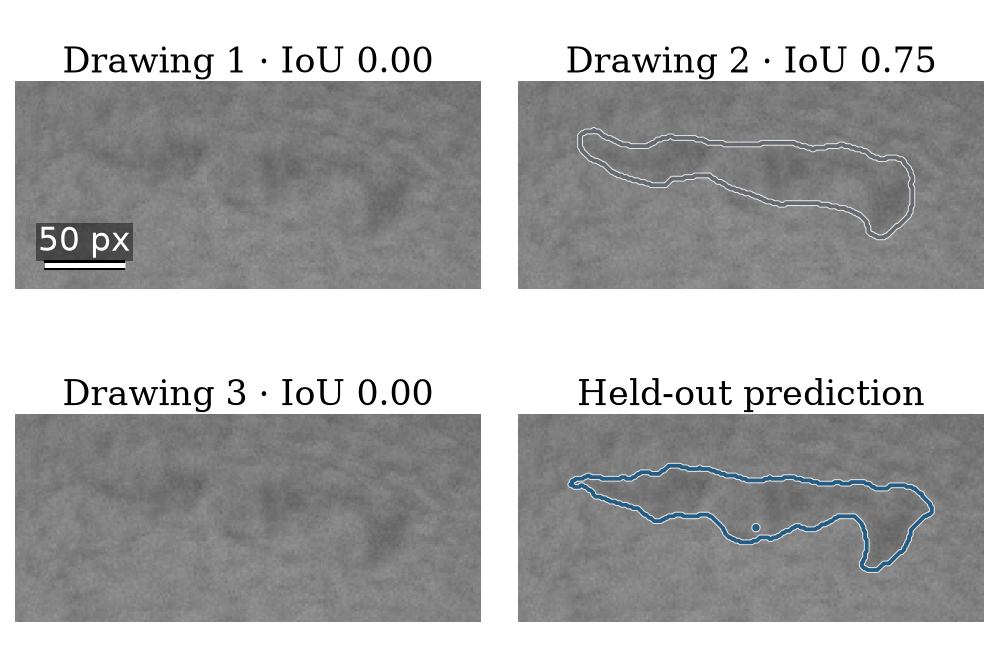

# Why minority support can improve PQ

The instance decision depends on expected score contribution across all
drawings. In the usual case with at most one strict match per record,
write `g = h * mu`: `h` is the fraction of drawings with IoU >0.5 and
`mu` is their mean matched IoU. A disjoint prediction improves pooled
PQ when `g > PQ/2`. A hit in most drawings is not required.

One frozen submitted OOF prediction on `20210201020330Lh` has best IoUs
`0, 0.75039135, 0` against its three drawings. Its observed `g` is
0.25013045, above half the pooled PQ, 0.22747559. Keeping it therefore
improves pooled PQ despite matching only one drawing. These are
label-based diagnostic values; inference predicts g from pixels.



Across all 4,707 frozen predicted masks, 180 have strict matches in a
positive minority of drawings. Of those, 76 have positive marginal PQ
contributions at the measured pooled score. The remaining minority cases
do not satisfy that criterion. This describes the frozen held-out masks;
it does not establish a new model improvement.

The [summary](../report/data/minority_support_summary.csv) and
[example](../report/data/minority_support_example.csv) contain full-precision
values. The example is the largest mask with positive surplus, area >200,
both bounding-box dimensions <384 and exactly one drawing overlapping it
at all. This fixed display rule provides an illustration, not an estimate
of how often a physical filament is omitted.

Rebuild the aligned native-pixel figure from official training data:

```sh
python -m tools.figures.minority_support --gt TRAIN_JSON --images TRAIN_IMAGES --pred report/data/oof_submitted.csv --out data/minority-support
```

The four panels show all drawings and the prediction on identical pixels.
The source and tests also handle the rare multiple-hit case using its
actual denominator increment; the scalar PQ/2 argument needs the stated
one-hit condition. See the [host-equivalent scorer](../filseg/metric.py).
